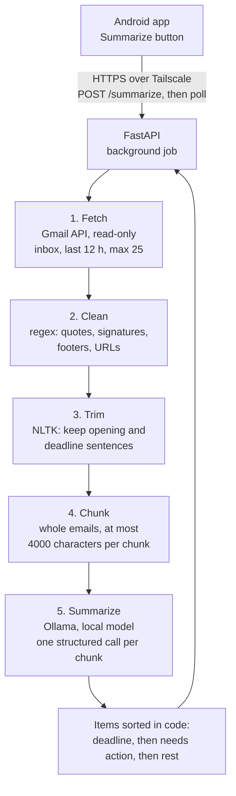

# Local Email Assistant

A private email summarizer that runs entirely on your own laptop. Tap **Summarize** in an Android app and get a prioritized digest of your recent Gmail, written by a small language model running locally in [Ollama](https://ollama.com). No email content is sent to any cloud AI service.

- **Backend** (`backend/`): Python + FastAPI. Fetches mail through the Gmail API (read-only), cleans and trims it, and summarizes it with a local model.
- **App** (`android_frontend/`): Kotlin + Jetpack Compose. Starts a summary, shows progress, and lists the results with the urgent emails first.
- **Link**: the phone reaches the laptop over [Tailscale](https://tailscale.com), a private encrypted network, so nothing is exposed to the public internet.

## How it works



1. **Fetch.** `fetch_since(hours)` or `fetch_latest(n)` read the newest inbox emails, skipping Promotions and Social, capped at 25. The result says if older emails were left out.
2. **Clean.** Regex removes quoted replies, signatures, unsubscribe footers and long URLs.
3. **Trim.** Emails over 1200 characters are cut with NLTK sentence scoring. The opening sentence and sentences that look time-sensitive (dates, times, "due", "please"...) are kept first.
4. **Chunk.** Whole emails are packed into chunks, so a sender and a deadline never get separated from their text.
5. **Summarize.** Each chunk is one call to the local model, constrained by a JSON schema (via Ollama's `format` option) to return, per email, a one-sentence summary, whether action is needed, and the deadline if one is stated. Sender, subject and date are copied from Gmail, never written by the model. Invalid answers are retried once; an email the model skips still appears, marked "Summary unavailable."

Because summarizing takes minutes on a CPU, `POST /summarize` starts a background job and returns an id at once. The app polls `GET /summarize/{id}` for progress and the result.

## Requirements

| Needed for | What |
| --- | --- |
| Backend | Python 3.10 or newer (developed on 3.13) |
| Local model | [Ollama](https://ollama.com), with a Qwen3 4B model pulled |
| Gmail | A Google Cloud project with the Gmail API enabled and a Desktop OAuth client |
| Phone link | [Tailscale](https://tailscale.com) on the laptop and the phone (free personal plan is enough) |
| App | Android Studio with AGP 9.3 support (2026.1 or newer), Android SDK platform 37, a phone running Android 8.0 (API 26) or newer |

## Setup

### 1. Backend

From `backend/` (PowerShell shown; on macOS/Linux use `.venv/bin/python`):

```powershell
python -m venv .venv
.venv\Scripts\python.exe -m pip install -r requirements.txt
.venv\Scripts\python.exe -m pip install -r requirements-dev.txt   # only for running tests
```

Pull the model:

```powershell
ollama pull qwen3:4b-instruct-2507-q4_K_M
```

Download the NLTK data into the project (the trimmer falls back to a plain regex splitter if it is missing):

```powershell
.venv\Scripts\python.exe -c "import nltk; [nltk.download(p, download_dir='nltk_data') for p in ('punkt_tab','stopwords')]"
```

Create a `.env` file from the template and set a token:

```powershell
copy .env.example .env
# then edit .env and set API_TOKEN to a long random string
```

### 2. Gmail access (one time)

1. In [Google Cloud Console](https://console.cloud.google.com/), create a project and enable the **Gmail API**.
2. Configure the OAuth consent screen as **External**, leave it in **Testing**, and add your Gmail address under **Test users**.
3. Create an **OAuth client ID** of type **Desktop app** and download the JSON.
4. Save it as `backend/secrets/credentials.json`.
5. Run `.venv\Scripts\python.exe -m scripts.test_gmail 3`. A browser opens for consent (the app requests only the read-only `gmail.readonly` scope) and `secrets/token.json` is created.

While the Google app is in Testing mode the login expires about every 7 days. Delete `secrets/token.json` and sign in again.

### 3. Run the API

```powershell
.venv\Scripts\python.exe -m scripts.run_api
```

Open http://127.0.0.1:8000/docs to try the endpoints. `GET /health` should report Ollama up with the model installed and Gmail signed in.

### 4. Connect the phone with Tailscale

1. Install Tailscale on the laptop and the phone and sign in to the same account.
2. In the Tailscale admin console, turn on **HTTPS certificates** (once).
3. On the laptop: `tailscale serve --bg 8000`. It prints an address like `https://<laptop>.<tailnet>.ts.net`.

The API stays bound to `127.0.0.1`; `tailscale serve` publishes it only inside your tailnet, with a real HTTPS certificate (Android blocks plain `http://`). The laptop must be awake with the API and Ollama running.

### 5. Android app

Open `android_frontend/` in Android Studio, let Gradle sync, and run it on your phone. In **Settings** enter your name, a device-name label, the `https://...ts.net` address from step 4, and the same token as `API_TOKEN`. The Home screen should show a green tick.

Command-line build (needs JDK 17 or newer as `JAVA_HOME`):

```powershell
cd android_frontend
.\gradlew.bat testDebugUnitTest assembleDebug
```

`android_frontend/initialising_doc.txt` records how the project was set up and how it differs from the Android Studio wizard.

## The app

| Screen | What it does |
| --- | --- |
| Home | Connection icon (green when the server's `/health` is ok), app name, **Summarize** button. Below it: orange "In process" with a progress bar, green "Done", or red "Failed" with the reason. |
| Digest | A lazy list of email cards: "Needs attention" first (deadline, then action needed), then everything else. Each card shows subject, sender, date, summary and Deadline / Action tags. The last digest is kept on the phone. |
| Settings | Your name, Tailscale device name, server address, token. |

## API

| Endpoint | Purpose |
| --- | --- |
| `GET /health` | Is Ollama reachable with the model installed, are Gmail credentials in place. Open; returns no email data. |
| `POST /summarize` | Start a job. Body `{"hours": 12}` or `{"latest": 20}` (not both); empty body uses `SUMMARY_WINDOW_HOURS`. Returns `202` and `job_id`. |
| `GET /summarize/{job_id}` | Status (`queued`, `fetching`, `summarizing`, `done`, `error`), progress (`step`, `total`, `stage`), and when done the `result`. |

`result` contains `items` (one object per email: `sender`, `subject`, `date`, `summary`, `needs_action`, `deadline`, `priority`, `summarized`), a plain-text `digest`, `email_count`, `chunk_count`, `model_calls`, `truncated` and `elapsed_seconds`. Failures carry `error.kind` (`gmail`, `ollama` or `internal`) and a message.

If `API_TOKEN` is set, `POST /summarize` and `GET /summarize/{id}` require `Authorization: Bearer <token>`. Jobs run one at a time and are kept in memory only.

## Configuration

Environment variables, or `backend/.env` (real environment variables win). Defaults are in `backend/app/config.py`.

| Variable | Default | Meaning |
| --- | --- | --- |
| `OLLAMA_HOST` | `http://localhost:11434` | Ollama server |
| `OLLAMA_MODEL` | `qwen3:4b-instruct-2507-q4_K_M` | Model used |
| `OLLAMA_TIMEOUT` | `300` | Seconds per request |
| `OLLAMA_NUM_CTX` | `8192` | Context window |
| `SUMMARY_WINDOW_HOURS` | `12` | Window used when a request gives no `hours` |
| `GMAIL_WINDOW_MAX_EMAILS` | `25` | Cap per run |
| `GMAIL_EXCLUDE_NOISE` | `true` | Skip Promotions and Social |
| `EMAIL_MAX_CHARS` | `1200` | Per-email size after trimming |
| `CHUNK_MAX_CHARS` | `4000` | Size of one model call |
| `API_HOST` / `API_PORT` | `127.0.0.1` / `8000` | Where the API listens |
| `API_TOKEN` | empty | Bearer token required by the API when set |

## Privacy and security

- **Email content stays local.** Summaries are produced by Ollama on your machine. The only network call to a third party is the Gmail API fetch, using your own account.
- **Read-only Gmail scope.** The app can read mail but cannot send, delete or change it.
- **Secrets stay out of git.** `credentials.json`, `token.json`, `.env` and `local.properties` are git-ignored. Never commit them.
- **API access.** The server listens on `127.0.0.1` only and is exposed to your tailnet through `tailscale serve` (not Tailscale Funnel). Keep `API_TOKEN` set.
- **On the phone.** The token is encrypted with an AES key held in the Android Keystore, only `https://` addresses are accepted, and cloud backup is switched off.

## Tests

```powershell
# backend (38 tests, no Gmail or model needed): from backend/
.venv\Scripts\python.exe -m pytest -q tests

# Android (7 JVM unit tests): from android_frontend/
.\gradlew.bat testDebugUnitTest
```

Helper scripts in `backend/scripts/`: `test_ollama`, `test_gmail`, `test_fetch_clean` (shows what cleaning and trimming remove), and `test_summary` (`--dry-run` shows the chunk plan without calling the model). Run them with `python -m scripts.<name>`.

## Project layout

```
backend/
  app/            config, schemas, jobs, main (FastAPI)
  app/services/   gmail_service, email_cleaner, email_trimmer, chunker,
                  ollama_service, summary_service
  scripts/        manual test and run scripts
  tests/          pytest suite
android_frontend/
  app/src/main/java/com/swapnil/localemail/
                  data/ (models, API client, settings, token encryption)
                  ui/   (view model, navigation, three screens)
  app/src/test/   unit tests (parses the backend's JSON shape)
```

## Limitations

- The model runs on CPU in the author's setup (about 12 tokens per second), so a busy window takes minutes. Speed depends on your hardware.
- A 4B model can miss a deadline or misjudge whether an email needs action. The output format is enforced; the content is not.
- Trimming is extractive, so a deadline in an unremarkable sentence of a very long email can be dropped.
- At most 25 emails per run; the app says when older ones were skipped.
- The laptop must be awake and running the API and Ollama for the app to work.

## Roadmap

- Optional: stored digests and scheduled runs (dropped for now because on-demand summaries need neither).
- Optional: retrieval over stored emails (RAG) with LlamaIndex and ChromaDB.

## License

No license has been chosen yet.
